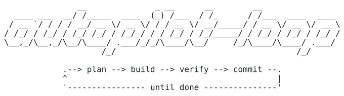

<p align="center">
  <picture>
    <source media="(prefers-color-scheme: dark)" srcset="assets/logo-dark.svg">
    
  </picture>
</p>

<p align="center">
  <a href="https://github.com/PlatinBit/autopilot-loop/actions/workflows/test.yml"></a>
  
  <a href="LICENSE"></a>
  
</p>

# autopilot-loop

**Give [Claude Code](https://claude.com/claude-code) a plan or an idea and it builds it task by task on its own – and only calls it "delivered" when your demo, a final review and a fresh checkout all pass.**

- **A shell script checks, not the model:** tests green, test count never drops, only allowed paths touched, locked files untouched. Only the script commits. [Safeguards](docs/REFERENCE.md#safeguards)
- **A read-only reviewer with a veto:** a second Claude reads diff and test output; a rejection resets the run and its reason goes into the next attempt. [How it works](docs/REFERENCE.md#how-it-works)
- **"Delivered" is earned:** `DEMO_CMD` exits 0, the final review finds nothing, tests and demo pass in a fresh checkout, then `main` is fast-forwarded and `HANDOVER.md` explains how to try it. [The end](docs/REFERENCE.md#the-end-final-review-fresh-checkout-merge)
- **Journal and lessons:** every agent leaves a note; the planner condenses them into at most 15 lessons for later prompts. [Journal and lessons](docs/REFERENCE.md#journal-and-lessons)
- **Cost under control:** caps per start and per call, model presets, effort per role, every call in `costs.csv`. [Configuration](docs/REFERENCE.md#configuration)

## What a run looks like

A real run, `history.log` shortened (the plan was written in German):

```text
2026-10-22 17:09:55 Final review (round 1): 1 new tasks
2026-10-22 17:10:27 Run 6 accepted: [x] 6. Überlauf bei mustergültigen, aber sehr großen Operanden abfangen: Liefert… | Tests 22 -> 24 | worker 0.1353624 USD
2026-10-22 17:10:39 Final review (round 2): OK
2026-10-22 17:10:55 Milestone 1 done: 4 tasks of Milestone 2 proposed. Read: autopilot plan – adopt: autopilot plan accept
2026-10-22 17:51:34 Start: 24 tests green, at most 50 runs or 1.2 USD, models balanced (planner opus, worker sonnet, reviewer sonnet), sandbox on
2026-10-22 17:51:59 Run 1 accepted: [x] 7. Multiplikation ergänzen: `*` in die Operator-Whitelist von `calc.py` aufnehmen,… | Tests 24 -> 28 | worker 0.122641 USD
[…]
2026-10-22 17:53:44 Fresh checkout: tests and demo green
2026-10-22 17:53:44 Merged into main (fast-forward) in ~/projects/rechner.
2026-10-22 17:53:44 Goal reached: all tasks done, demo green, merged into main.
```

The final review of milestone 1 found that a 400-digit operand crashed the calculator and added task 6 for it. The whole 10-task project, planning included, cost 3.74 USD.

## Quick start

1. **Install** – in a Claude Code session:
   ```
   /plugin marketplace add PlatinBit/autopilot-loop
   /plugin install autopilot@autopilot-loop
   ```
2. **Plan** – Claude drafts tasks, test and demo command; read the draft, then accept it:
   ```
   /autopilot-loop plan A CLI that counts words in Markdown files
   /autopilot-loop plan accept
   ```
3. **Start** – runs in the background until delivered, not delivered or a cap is hit:
   ```
   /autopilot-loop start
   ```

Needs Linux or WSL, Bash 4.4+, `git`, `tmux`, `jq` and Claude Code 2.1+; `autopilot doctor` checks it. The terminal command `autopilot` works without Claude Code: [Installation](docs/REFERENCE.md#installation).

## How it works

- **The worker** (Claude) does one small task per run, with a fresh context and no Git access.
- **A shell script** checks the result with hard rules; anything that fails is reset, and the reason goes into the next attempt.
- **The reviewer** (a second Claude, read-only tools) rejects weak tests and fakes; only then the script commits.
- **At the end** the script runs the demo, a final review of the whole change and tests and demo in a fresh checkout, then merges and writes a handover. Otherwise the outcome is "not delivered".
- **Large plans** go milestone by milestone; the planner drafts the next one's tasks itself.
- **Test and demo commands** run in a bubblewrap sandbox; the worker's own Bash calls only through the bundled `sandbox-run`. It is not a security boundary: [Security](docs/REFERENCE.md#security).

Flowchart and details: [How it works](docs/REFERENCE.md#how-it-works).

## Commands

In Claude Code as `/autopilot-loop <command>`, in the terminal as `autopilot <command>`:

| No. | Command | Effect |
|---|---|---|
| 1 | `plan <file>` / `plan "<idea>"` | Claude drafts tasks, test and demo command |
| 2 | `plan accept` | adopts the draft and sets up the work branch |
| 3 | `start` | runs the loop in the background |
| 4 | `status` | progress, outcome, tests, cost |
| 5 | `stop [--now]` | stop after the current run, or now |
| 6 | `handover` | what was built, how to try it, the proof |

All commands and settings: [Commands](docs/REFERENCE.md#commands), [Configuration](docs/REFERENCE.md#configuration). Full reference: [docs/REFERENCE.md](docs/REFERENCE.md).

## Status

A hobby project. Tested on Linux (the self-test runs in CI on Ubuntu); macOS is untested. `PARALLEL` > 1 and `MERGE=pr` are experimental. [Issues](https://github.com/PlatinBit/autopilot-loop/issues) and reports from real runs are welcome.

License: [MIT](LICENSE).
