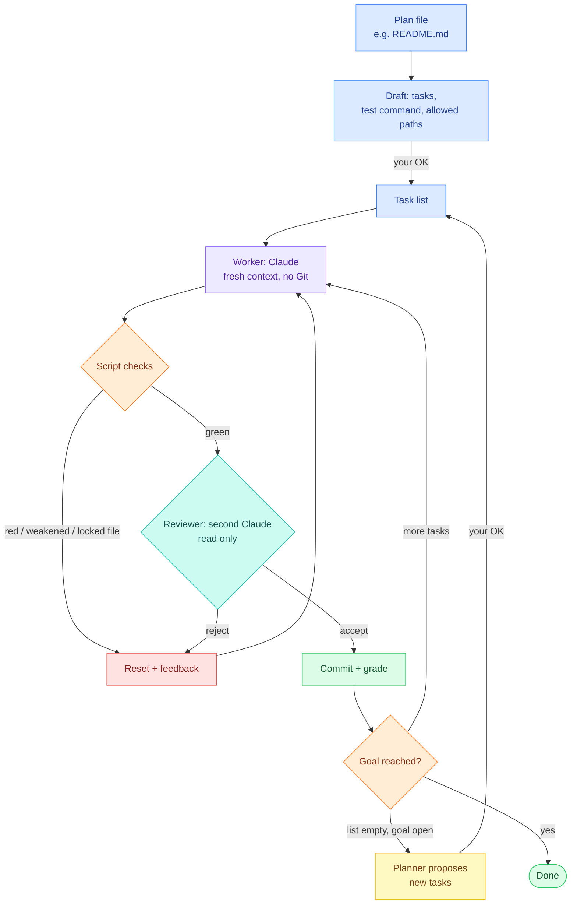
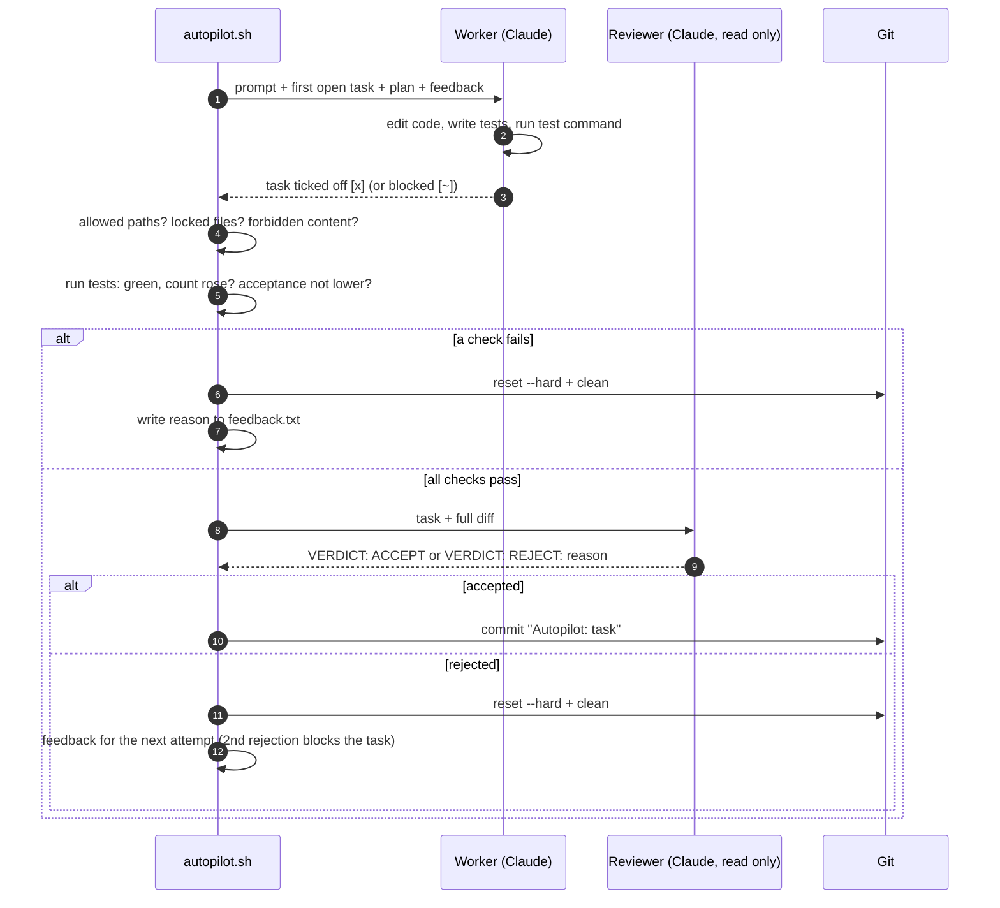

<p align="center">
  <picture>
    <source media="(prefers-color-scheme: dark)" srcset="assets/logo-dark.svg">
    
  </picture>
</p>

<p align="center">
  
  
</p>

**Point it at a plan file and [Claude Code](https://claude.com/claude-code) implements it on its own, one task at a time. A loop of script checks, a read-only reviewer and a locked goal makes sure that "done" really means done.**

## The idea

Let Claude run all night and in the morning it says "Done!" – and nothing works. The reason: whoever builds also checks their own work. autopilot-loop separates the two:

- **Claude (the worker)** writes code, one small task per run, with a fresh context and no Git access.
- **Optional: a stronger planner** writes a brief for every task (files, approach, test, pitfalls), so a cheaper worker can build it: e.g. Opus plans, Sonnet builds, Opus reviews.
- **A shell script** checks the result with hard rules: tests green, test count never drops, only allowed paths touched, the goal untouched.
- **A second Claude (the reviewer)** reads the diff with read-only tools and rejects weak tests and fakes.
- **Only the script commits.** Anything that fails is reset, and the reason goes into the next attempt.

## The flow



| Colour | Meaning |
|---|---|
| Blue | Plan, draft and task list (your input, approved by you) |
| Purple | Worker: Claude writing code |
| Orange | Script checks: plain shell, no AI judgement |
| Teal | Reviewer: a second Claude with read-only tools |
| Green | Commit: only the script commits |
| Red | Reject: reset the work directory and feed the reason back |
| Yellow | Planner: proposes follow-up tasks, adopted only with your OK |

### Life of one run



## How it works

1. **Plan.** You point `autopilot plan <file>` at a description of what should be built. Claude reads the plan and the project (read only) and drafts small tasks, each ending with "Done when …", plus a test command and the paths it may change.
2. **Approve.** You read the draft. Only a few settings are taken over, in a strictly checked form. `autopilot plan accept` creates a separate worktree on a branch `autopilot`, so your own working copy stays untouched.
3. **Run.** Each run starts a fresh `claude -p` with the first open task, the plan and – after a rejection – the reason. Claude has only the allowed tools and no Git.
4. **Check.** The script stages the changes and rejects the run if no task was ticked off, a file outside `ALLOWED` or a locked file changed, forbidden content was added, the tests are red, the test count dropped, a task was ticked off without a new test, or the acceptance count dropped.
5. **Review.** For a completed task a second Claude reads the task and the full diff with read-only tools and answers `VERDICT: ACCEPT` or `VERDICT: REJECT: <reason>`. Two rejections of the same task mark it as blocked (`- [~]`) and move on.
6. **Commit or reset.** Accepted work is committed by the script; everything else is reset with `git reset --hard` and the reason is passed to the next attempt.
7. **Grade.** Every result counts towards the task kind (`[tag]`). A kind earns a licence at 95 % over 20 runs and loses it below 90 %. With `SUPERVISED=on`, kinds without a licence pause after each task until you say `autopilot continue`.
8. **Finish or plan more.** When the list is empty and the goal is reached, the loop ends (optionally with a smoke test). If the acceptance test is still open, the planner proposes the next tasks – adopted only with your OK.

## Safeguards

| No. | Building block | What it prevents |
|---|---|---|
| 1 | **Plan file as the goal**: passed to every run and locked | the loop rewriting its own goal |
| 2 | **One task per run, fresh context** | getting lost in old failed attempts, a full context |
| 3 | **Script checks** (no AI judgement): tests green, count never drops, every ticked-off task adds tests, only allowed paths, locked files untouched, no forbidden content | "done" without proof, deleted tests, tampering with the checks or the plan |
| 4 | **Reviewer**: second Claude session, read only, optionally a different model | weak tests, fakes with fixed numbers |
| 5 | **Acceptance test** (optional): a measurable overall goal, approved by you (checksum) | progress only on paper |
| 6 | **Feedback**: the reason for each rejection goes into the next attempt | blindly repeating the same mistake |
| 7 | **Grades and licence** per task kind; `SUPERVISED=on` waits for your OK until a kind has earned it | trust that was never earned |
| 8 | **Brakes**: stop after n rejections in a row, tasks blocked after two reviewer rejections or two time-outs (too big for one run), a maximum number of runs, stall warning, waiting at the usage limit | endless loops that only burn quota |
| 9 | **Planner**: list empty, goal open → proposes the next tasks, adopted only with your OK | standstill at "no tasks left" |
| 10 | **Visibility**: cost per run, progress chart as a web page, daily report, status line in Claude Code | surprises in cost and progress |

## Requirements

Linux or WSL (macOS 12.3+ untested), Bash 4.4 or newer, `git`, `tmux`, `jq`, `python3`, `timeout` (macOS: `gtimeout`), [Claude Code](https://claude.com/claude-code) with a login (subscription or API key); `whiptail` only for the terminal menu.

## Installation

**As a Claude Code plugin** (contains everything) – in a Claude Code session:

```
/plugin marketplace add PlatinBit/autopilot-loop
/plugin install autopilot@autopilot-loop
```

Afterwards `/autopilot` opens the menu as a selection list, and running projects show up in the status line. Update: `/plugin` → Marketplaces → autopilot-loop → Update.

**Optionally in the terminal** (for the `autopilot` command without Claude, e.g. for cron):

```bash
git clone https://github.com/PlatinBit/autopilot-loop.git ~/autopilot-loop
~/autopilot-loop/install.sh        # checks the requirements and links `autopilot` into ~/.local/bin
```

## Quick start

```bash
autopilot plan ~/my-project/README.md   # Claude drafts tasks, test command and paths
autopilot plan accept                   # after reading: set up the "autopilot" worktree next to the project
autopilot                               # menu → Start
```

Or in Claude Code: `/autopilot` → "New project from file".

- **Plan file inside a Git project** (an existing codebase): work happens in a separate worktree `<project>-autopilot` on branch `autopilot`, so your working copy stays untouched; adopt the result with `git merge autopilot`.
- **Plan file anywhere else** (e.g. `~/idea.md` for something new): a project folder `<name>-autopilot/` is created next to it with its own Git repository and a copy of the plan, and Claude builds everything there. Nothing else on your system is changed – no `git init` in your folders, no change to your global Git settings.

**The better the plan, the further the autopilot gets on its own.** Describe what should work in the end, ideally with examples and limits. Whatever cannot be checked automatically (look, usability) is yours to check.

Manual setup also works: `autopilot setup` creates a commented [`autopilot.conf`](templates/autopilot.conf); a Gradle example is in [`examples/gradle.conf`](examples/gradle.conf).

## Commands

| No. | Command | Effect |
|---|---|---|
| 1 | `autopilot` / `/autopilot` | menu |
| 2 | `autopilot plan <file>` / `plan show` / `plan accept` | draft a new project from a plan file / show the draft / set it up |
| 3 | `autopilot start 10 opus 3 sonnet opus` | 10 runs, reviewer opus, stop after 3 rejections in a row, builder sonnet, planner opus (writes a brief for every task, because builder and planner differ) |
| 4 | `autopilot status [--short]` | running?, acceptance, tasks, latest events |
| 5 | `autopilot continue` | approve the supervised step (with `SUPERVISED=on`) |
| 6 | `autopilot stop` / `abort` | stop after the current run / stop now and discard the unfinished run |
| 7 | `autopilot grades` / `costs` / `chart` | grade table / cost per day and model / progress chart as an HTML page |
| 8 | `autopilot propose` / `suggestion [accept\|discard]` | run the planner / view and adopt its suggestion |
| 9 | `autopilot report [--if-new]` | summary of the last 24 hours, also sent as a notification |
| 10 | `autopilot approve` / `conditions` | approve the acceptance test / list its conditions |
| 11 | `autopilot notes` / `result` | decisions and blocked tasks / new commits |
| 12 | `autopilot trust [file]` | confirm a hand-written or changed `autopilot.conf` |

Daily report via cron (`crontab -e`): `30 7 * * * $HOME/.local/bin/autopilot report --if-new`. Notifications (mail, desktop, chat) are set up with a function `notify()` in `autopilot.conf`.

Logs, progress, grades, approval and suggestions live in `.autopilot/` next to `autopilot.conf`; the work directory is kept clean through `.git/info/exclude`.

## Limits

| No. | Limit | How to deal with it |
|---|---|---|
| 1 | Only what can be checked automatically is checked | look, feel and UX stay with humans; for apps and games there is `SMOKE_TEST_CMD` with an optional image review |
| 2 | The reviewer can be wrong (both ways) | at most two rejections per task, then it lands with you |
| 3 | Cost | with a subscription the loop pauses at the usage limit; with an API key always set a maximum number of runs; `autopilot costs` shows usage |
| 4 | Security | see below |

## Security

The checks protect the **quality** of the work. They are **not a security boundary**: the test command runs code Claude wrote, with your permissions. What is built in:

| No. | Protection | Against |
|---|---|---|
| 1 | An `autopilot.conf` is only loaded once you confirmed it (`autopilot trust`, automatic after `plan accept`); every change needs a new confirmation | foreign repos with a prepared `autopilot.conf`, changes by the worker |
| 2 | Only a few settings from Claude's draft are adopted, in a strictly checked form; tools only `Read`, `Edit`, `Write`, `Glob`, `Grep` and `Bash` for a single command | prompt injection through the plan or the project |
| 3 | Paths and names are quoted safely when the configuration is written | prepared file and branch names |
| 4 | All Claude runs without project settings (`--setting-sources user`) and without write access to `.git`, `.claude`, `.autopilot`, `autopilot.conf` | hooks and permissions from a foreign `.claude/settings.json` |
| 5 | Git without hooks, fsmonitor and external diff programs; if a run changes `.git` (config, info, hooks), the autopilot stops immediately | code execution through Git management files |
| 6 | `.git*`, `.github/`, `.claude/`, `.autopilot/`, `autopilot.conf`, `CLAUDE.md` are always locked; renames are checked with old and new path | bypassing the path check |
| 7 | Numbers must be numbers; new code that prints the count line itself is rejected | faked test counts |

**Recommendation:** for your own plans in your own projects this is enough. For plans or repos from others, run the autopilot in a container or VM without access to keys and private data. Never use `--dangerously-skip-permissions` on your own system. Read drafts before accepting them: `TEST_CMD` and `TEST_COUNT_CMD` are run as shell commands (a draft never sets up an acceptance test: `ACCEPT_CMD` needs locked `ACCEPT_FILES`, set both by hand).

## Self-test

```bash
test/test_autopilot.sh       # fake `claude`: loop, plan file, security filter, supervised mode, planner, report → "ok"
claude plugin validate . && claude plugin test .
```

License: MIT.
