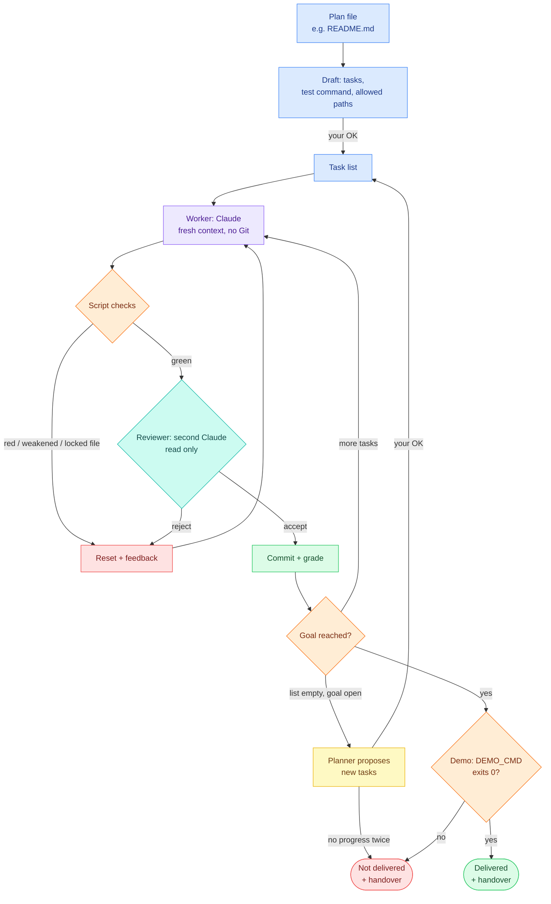
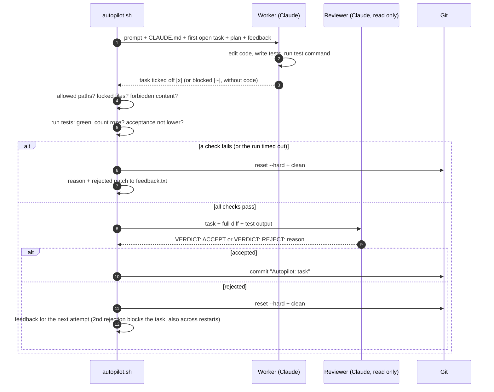

<p align="center">
  <picture>
    <source media="(prefers-color-scheme: dark)" srcset="assets/logo-dark.svg">
    
  </picture>
</p>

<p align="center">
  
  
</p>

**Point it at a plan file and [Claude Code](https://claude.com/claude-code) implements it on its own, one task at a time. A loop of script checks, a read-only reviewer and a locked goal guards every task, and a demo command at the end decides whether the result is "delivered" – shown to work and handed over with instructions – or not.**

## The idea

Let Claude run all night and in the morning it says "Done!" – and nothing works. The reason: whoever builds also checks their own work, and a list of ticked-off tasks is not a working result. autopilot-loop separates the two and ends with a demo:

- **Claude (the worker)** writes code, one small task per run, with a fresh context and no Git access.
- **Optional: a stronger planner** writes a brief for every task (files, approach, test, pitfalls), so a cheaper worker can build it: e.g. Opus plans, Sonnet builds, Opus reviews.
- **A shell script** checks the result with hard rules: tests green, test count never drops, only allowed paths touched, the goal untouched.
- **A second Claude (the reviewer)** reads the diff and the test output with read-only tools and rejects weak tests and fakes.
- **Only the script commits.** Anything that fails is reset, and the reason (with the rejected patch) goes into the next attempt.
- **At the end the script runs the demo** (`DEMO_CMD`: start or use the result the way you would) and writes a handover. Without a passing demo the outcome is "not delivered", however many tasks are ticked off.

## What you get at the end

Every loop ends with three things in `.autopilot/` next to `autopilot.conf`:

| No. | File | Content |
|---|---|---|
| 1 | `outcome` | one line: `delivered`, `not-delivered`, `stopped`, `limit` or `error`, tab, the reason |
| 2 | `HANDOVER.md` | the result in plain words: what was built (commits), how to try it (`TRY_IT`), the proof (output of the demo), what is still open (blocked tasks, open acceptance conditions), the next step |
| 3 | `demo.txt` | the output of `DEMO_CMD` |

`autopilot handover` (or `/autopilot-loop handover`) shows them; the finish toast and `autopilot summary --short` start with the outcome. **"Delivered" means: all tasks done, the acceptance test (if any) met, and `DEMO_CMD` exited 0.** `DEMO_CMD` is one command that uses the finished result like its owner would (`python app.py --help`, `./bin/tool examples/a.md`, `npm start -- --check`); if it is empty the loop falls back to `SMOKE_TEST_CMD`, and if both are empty the result can never be reported as delivered – it ends as "not delivered: no demo". `autopilot plan` proposes `DEMO_CMD` and `TRY_IT` from the plan's "Deliverable" section, and `plan accept` refuses to set up a project without a demo unless you say `--no-demo`.

## The flow



| Colour | Meaning |
|---|---|
| Blue | Plan, draft and task list (your input, approved by you) |
| Purple | Worker: Claude writing code |
| Orange | Script checks and the demo: plain shell, no AI judgement |
| Teal | Reviewer: a second Claude with read-only tools |
| Green | Commit: only the script commits; delivered: the demo passed |
| Red | Reject: reset the work directory and feed the reason back; not delivered: the demo failed or the planner made no progress |
| Yellow | Planner: proposes follow-up tasks, adopted only with your OK |

### Life of one run



## How it works

1. **Plan.** You point `autopilot plan <file>` at a description of what should be built. Claude reads the plan and the project (read only) and drafts small tasks, each ending with "Done when …", the last one end to end ("Done when `<DEMO_CMD>` exits 0 and prints …"), plus a test command, a demo command (`DEMO_CMD`, `TRY_IT`) and the paths it may change.
2. **Approve.** You read the draft. Only a few settings are taken over, in a strictly checked form. `autopilot plan accept` creates a separate worktree on a branch `autopilot`, so your own working copy stays untouched. It refuses a draft without a demo command (`--no-demo` overrides, and the result can then never be "delivered"); an acceptance test the draft proposes is adopted only with `--with-accept`.
3. **Run.** Each run starts a fresh `claude -p --safe-mode` with the first open task, the plan, the project's `CLAUDE.md` and – after a rejection – the reason and the rejected patch. Claude has only the allowed tools and no Git.
4. **Check.** The script stages the changes and rejects the run if no task was ticked off, a file outside `ALLOWED` or a locked file changed, forbidden content was added, the tests are red, the test count dropped, a task was ticked off without a new test, a blocked task (`- [~]`) comes with code, or the acceptance count dropped. A run that hits its time limit is rejected with that as feedback.
5. **Review.** For a completed task a second Claude reads the task, the full diff and the test output with read-only tools and answers `VERDICT: ACCEPT` or `VERDICT: REJECT: <reason>`. Two rejections of the same task mark it as blocked (`- [~]`) and move on – counted in `.autopilot/attempts`, so a restart does not reset the count.
6. **Commit or reset.** Accepted work is committed by the script; everything else is reset with `git reset --hard` and the reason is passed to the next attempt.
7. **Grade.** Every result counts towards the task kind (`[tag]`). A kind earns a licence at 95 % over 20 runs and loses it below 90 %. With `SUPERVISED=on`, kinds without a licence pause after each task until you say `autopilot continue`.
8. **Plan more.** If the list is empty but the acceptance test is still open, the planner proposes the next tasks (it sees its previous suggestion and the demo output, never re-proposes finished work, and says so when the goal cannot be reached through tasks) – adopted only with your OK. Two planner rounds without progress end the loop as "not delivered".
9. **Demo and handover.** At the end of every loop the script runs `DEMO_CMD` (or `SMOKE_TEST_CMD`), writes `.autopilot/outcome` and `.autopilot/HANDOVER.md`, and tells you: delivered, or not delivered and why.

## Safeguards

| No. | Building block | What it prevents |
|---|---|---|
| 1 | **Plan file as the goal**: passed to every run and locked | the loop rewriting its own goal |
| 2 | **One task per run, fresh context** | getting lost in old failed attempts, a full context |
| 3 | **Script checks** (no AI judgement): tests green, count never drops, every ticked-off task adds tests, only allowed paths, locked files untouched, no forbidden content | "done" without proof, deleted tests, tampering with the checks or the plan |
| 4 | **Reviewer**: second Claude session, read only, optionally a different model | weak tests, fakes with fixed numbers |
| 5 | **Acceptance test** (optional): a measurable overall goal, approved by you (checksum) | progress only on paper |
| 6 | **Feedback**: the reason for each rejection and the rejected patch go into the next attempt; a time-out is feedback too | blindly repeating the same mistake, starting from zero after a near miss |
| 7 | **Grades and licence** per task kind; `SUPERVISED=on` waits for your OK until a kind has earned it | trust that was never earned |
| 8 | **Brakes**: n rejections in a row block the task, tasks blocked after two reviewer rejections or two time-outs (too big for one run), counted in `.autopilot/attempts` so a restart does not reset them; a maximum number of runs, stall warning, waiting at the usage limit | endless loops that only burn quota, restarting around a brake |
| 9 | **Planner**: list empty, goal open → proposes the next tasks, adopted only with your OK; two rounds without progress end the loop as not delivered; a blocked task may not come with code | standstill at "no tasks left", invented tasks, half-built work slipping in as "blocked" |
| 10 | **Demo and handover**: `DEMO_CMD` runs at the end, its output is the proof in `HANDOVER.md`; no passing demo, no "delivered" | "done" that nobody can start |
| 11 | **Visibility**: outcome and handover, cost per run, progress chart as a web page, daily report, status line in Claude Code | surprises in cost and progress |

## Requirements

Linux or WSL (macOS 12.3+ untested), Bash 4.4 or newer, `git`, `tmux`, `jq`, `python3`, `timeout` (macOS: `gtimeout`), [Claude Code](https://claude.com/claude-code) with a login (subscription or API key); `whiptail` only for the terminal menu.

## Installation

**As a Claude Code plugin** (contains everything) – in a Claude Code session:

```
/plugin marketplace add PlatinBit/autopilot-loop
/plugin install autopilot@autopilot-loop
```

Afterwards `/autopilot-loop` opens the menu as a selection list, and running projects show up in the status line. Without `install.sh` there is no `autopilot` command in the terminal: every command below works in Claude Code as `/autopilot-loop <command>`, e.g. `/autopilot-loop trust <file>`.

Update: `/plugin` → Marketplaces → autopilot-loop → Update. Plugin code runs unattended and `trust` only covers `autopilot.conf`, not the plugin itself, so turn off auto-update for this marketplace and update by hand after reading the changes.

**Optionally in the terminal** (for the `autopilot` command without Claude, e.g. for cron):

```bash
git clone https://github.com/PlatinBit/autopilot-loop.git ~/autopilot-loop
~/autopilot-loop/install.sh        # checks the requirements and links `autopilot` into ~/.local/bin
autopilot doctor                   # checks everything at any time: tools, versions, install commands, project
```

## Quick start

```bash
autopilot plan ~/my-project/README.md   # Claude drafts tasks, test command and paths
autopilot plan accept                   # after reading: set up the "autopilot" worktree next to the project
autopilot                               # menu → Start
```

Or in Claude Code: `/autopilot-loop` → "New project from file".

**Only an idea, no plan file yet?**

```bash
autopilot plan idea "A CLI tool that counts words in Markdown files, with tests"
```

Claude writes `./<slug>-plan.md` from it: goal, constraints, verifiable milestones. Read and edit that file, then continue with `autopilot plan <that file>` as above. In Claude Code: `/autopilot-loop` → "New project from an idea".

- **Plan file inside a Git project** (an existing codebase): work happens in a separate worktree `<project>-autopilot` on branch `autopilot`, so your working copy stays untouched; adopt the result with `git merge autopilot`.
- **Plan file anywhere else** (e.g. `~/idea.md` for something new): a project folder `<name>-autopilot/` is created next to it with its own Git repository and a copy of the plan, and Claude builds everything there on branch `autopilot` (`main` keeps the plan; adopt with `git checkout main && git merge autopilot`). Nothing else on your system is changed – no `git init` in your folders, no change to your global Git settings.

**The better the plan, the further the autopilot gets on its own.** Describe what should work in the end, ideally with examples and limits, and give it a "Deliverable" section: what you hold in your hands at the end, how you try it, and the one command that proves it (this becomes `DEMO_CMD`). Whatever cannot be checked automatically (look, usability) is yours to check.

Manual setup also works: `autopilot setup` creates a commented [`autopilot.conf`](templates/autopilot.conf); a Gradle example is in [`examples/gradle.conf`](examples/gradle.conf).

## Commands

| No. | Command | Effect |
|---|---|---|
| 1 | `autopilot` / `/autopilot-loop` | menu |
| 2 | `autopilot plan <file>` / `plan idea "<idea>"` / `plan show` / `plan accept [--no-demo] [--with-accept]` | draft a new project from a plan file / write a plan file from a bare idea / show the draft / set it up (`--no-demo`: without a demo command, never "delivered"; `--with-accept`: adopt the acceptance test the draft proposes) |
| 3 | `autopilot start 10 opus 3 sonnet opus` | discards unfinished changes in the work directory (`git reset --hard`, `git clean`), then 10 runs, reviewer opus, stop after 3 rejections in a row, builder sonnet, planner opus (writes a brief for every task, because builder and planner differ) |
| 4 | `autopilot status [--short]` / `summary [--short]` / `handover` | running?, acceptance, tasks, latest events / end summary of the last start, outcome first (from the logs, free) / outcome and `HANDOVER.md`: what was built, how to try it, the demo output, what is open |
| 5 | `autopilot continue` | approve the supervised step (with `SUPERVISED=on`) |
| 6 | `autopilot stop` / `abort` | stop after the current run / stop now and discard the unfinished run (`git reset --hard` and `git clean` in the work directory) |
| 7 | `autopilot grades` / `costs` / `chart` | grade table / cost per day and model / progress chart as an HTML page |
| 8 | `autopilot propose` / `suggestion [accept\|discard]` | run the planner / view and adopt its suggestion |
| 9 | `autopilot report [--if-new]` | summary of the last 24 hours, also sent as a notification |
| 10 | `autopilot approve` / `conditions` | approve the acceptance test / list its conditions |
| 11 | `autopilot notes` / `result` | decisions and blocked tasks / new commits |
| 12 | `autopilot trust [file]` | confirm a hand-written or changed `autopilot.conf` |
| 13 | `autopilot doctor` | checklist of everything needed: ✔/✘ per tool with version, purpose and install command, git identity, sandbox state and a probe of the project's test command |

Daily report via cron (`crontab -e`): `30 7 * * * $HOME/.local/bin/autopilot report --if-new`. Desktop notifications work out of the box where `notify-send` exists; a function `notify()` in `autopilot.conf` replaces them (mail, chat …).

Logs, progress, grades, approval, suggestions, outcome and handover live in `.autopilot/` next to `autopilot.conf`; the work directory is kept clean through `.git/info/exclude`.

## How do I know it is done?

"Done" has one meaning: the outcome is `delivered` – every task ticked off, the acceptance test (if any) met, `DEMO_CMD` exited 0. Everything else is "not delivered" with a reason, even with an empty task list. Where you see it:

| No. | Signal | Where |
|---|---|---|
| 1 | Status line with the progress while it runs, then "Autopilot <name>: Delivered …" or "Not delivered (reason) …" until the next session or start | Claude Code, below the input |
| 2 | Finish toast, outcome first: "Autopilot <name>: Delivered - 5 done, 1 blocked, tests 114 -> 131, 4.20 USD - /autopilot-loop handover" | Claude Code |
| 3 | `autopilot handover`: `HANDOVER.md` – what was built, how to try it, the demo output as proof, what is open, next step | terminal, `/autopilot-loop handover` or the menu under "More" |
| 4 | `autopilot summary [--short]`: outcome, tasks, tests, cost and duration of the last start – from the logs, no Claude call | terminal or `/autopilot-loop summary` |
| 5 | Desktop notification on start, end and warnings: the default `notify()` uses `notify-send` where it exists (otherwise silent); your own `notify()` in `autopilot.conf` replaces it (mail, chat …) | desktop |
| 6 | `autopilot report [--if-new]`: summary of the last 24 hours, e.g. via cron | terminal, plus `notify()` |

## Limits

| No. | Limit | How to deal with it |
|---|---|---|
| 1 | Only what can be checked automatically is checked | look, feel and UX stay with humans; the demo proves that the result starts and answers, not that it is pleasant; for apps and games there is `SMOKE_TEST_CMD` with an optional image review |
| 2 | Without `DEMO_CMD` (or `SMOKE_TEST_CMD`) and without `ACCEPT_CMD`, "finished" only means "the list is empty": the outcome is then always "not delivered" | set `DEMO_CMD`: one command that uses the result like you would; `autopilot plan` proposes one from the plan |
| 3 | The reviewer can be wrong (both ways) | at most two rejections per task, then it lands with you |
| 4 | The planner can run out of ideas or invent work | it sees its previous suggestion and the demo output; two rounds without acceptance progress end the loop (allow new rounds: `rm .autopilot/planner-rounds`, done by itself when you adopt a suggestion); it is told to say "not reachable" instead of inventing tasks |
| 5 | Cost | with a subscription the loop pauses at the usage limit; with an API key always set a maximum number of runs; `autopilot costs` shows usage |
| 6 | Security | see below |

## Upgrading from 0.7

| No. | Change | What to do |
|---|---|---|
| 1 | New settings `DEMO_CMD` and `TRY_IT` | add them to `autopilot.conf` (see the [template](templates/autopilot.conf)); without them the outcome is never "delivered" |
| 2 | Claude runs with `--safe-mode`: no hooks, plugins, MCP servers or automatic `CLAUDE.md`, so the project's `CLAUDE.md` is now embedded in the prompt instead of being read by Claude Code | nothing, unless your `CLAUDE.md` relied on `@includes` or hooks |
| 3 | Brakes persist in `.autopilot/attempts`, planner rounds in `.autopilot/planner-rounds`; `MAX_REJECTIONS` blocks the task instead of ending the loop | a restart continues where the brake left off; delete the file to reset by hand (`planner-rounds` is reset when you adopt a suggestion) |
| 4 | `autopilot plan accept` refuses a draft without a demo command | run `autopilot plan <file>` again with a plan that has a "Deliverable" section, or `plan accept --no-demo` |

## Security

The checks protect the **quality** of the work. They are **not a security boundary**: the test command runs code Claude wrote, with your user rights – including every device your user can open (`/dev`, e.g. `i2c` or `hidraw` with loose udev rules) and every local hardware tool. Best run the autopilot on a separate machine, VM or container. On Linux, `SANDBOX=on` (needs bubblewrap) runs the test, acceptance and smoke commands without network and devices, read-only outside the work directory and with a read-only `.git` and `.autopilot/` (without `SANDBOX=on` the test command could edit the autopilot's own state – approval, brakes, feedback – so that is no security boundary either). **The worker's own Bash calls are NOT covered by it**: either give the worker no Bash rights beyond the test command, or route them through the bundled `sandbox-run` wrapper (the same bubblewrap call), e.g. `WORKER_TOOLS=(… 'Bash(<plugin>/sandbox-run pytest:*)')` – `autopilot plan accept` sets this up by itself when bubblewrap works on the machine. What is built in:

| No. | Protection | Against |
|---|---|---|
| 1 | An `autopilot.conf` is only loaded once you confirmed it (`autopilot trust`, automatic after `plan accept`); every change needs a new confirmation | foreign repos with a prepared `autopilot.conf`, changes by the worker |
| 2 | Only a few settings from Claude's draft are adopted, in a strictly checked form; tools only `Read`, `Edit`, `Write`, `Glob`, `Grep` and `Bash` for a single command | prompt injection through the plan or the project |
| 3 | Paths and names are quoted safely when the configuration is written | prepared file and branch names |
| 4 | All Claude runs without project settings (`--safe-mode`; the project's `CLAUDE.md` goes into the prompt as text) and without write access to `.git`, `.claude`, `.autopilot`, `autopilot.conf` | hooks and permissions from a foreign `.claude/settings.json` |
| 5 | Git without hooks, fsmonitor and external diff programs; if a run changes `.git` (config, info, hooks), the autopilot stops immediately | code execution through Git management files |
| 6 | `.git*`, `.github/`, `.claude/`, `.autopilot/`, `autopilot.conf`, `CLAUDE.md` are always locked; renames are checked with old and new path | bypassing the path check |
| 7 | Numbers must be numbers; new code that prints the count line itself is rejected | faked test counts |

**Recommendation:** for your own plans in your own projects this is enough. For plans or repos from others, run the autopilot in a container or VM without access to keys and private data. Never use `--dangerously-skip-permissions` on your own system. Read drafts before accepting them: `TEST_CMD`, `TEST_COUNT_CMD`, `DEMO_CMD` and `ACCEPT_CMD` are run as shell commands. An acceptance test in a draft is only a proposal (existing files, plain paths): it is dropped unless you run `plan accept --with-accept`, and its files are locked afterwards.

## Self-test

```bash
test/test_autopilot.sh       # fake `claude`: loop, plan file, security filter, supervised mode, planner, demo, handover → "ok"
claude plugin validate . && claude plugin test .   # the Claude Code plugin: menu, status line, finish toast
```

License: MIT.
