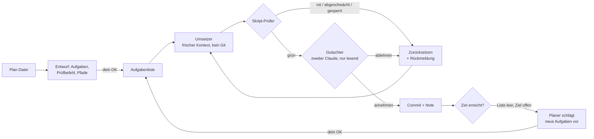

# autopilot-loop

**Gib eine Plan-Datei an – Claude Code setzt sie Aufgabe für Aufgabe allein um. Ein Regelkreis aus Skript-Prüfer, Gutachter und gesperrtem Ziel sorgt dafür, dass „fertig“ wirklich fertig heißt.**

*English summary: Point it at a plan file (e.g. `README.md`) and an autonomous loop for [Claude Code](https://claude.com/claude-code) implements it. Claude drafts small, testable tasks, you approve the draft, then Claude takes one task per run with a fresh context and no git access. A shell script verifies each run (tests green, test count never drops, only allowed paths, plan file locked), a second read-only Claude reviews it, and only then is it committed – otherwise it is reset and the reason is fed into the next attempt. Includes per-task-type grades with an earned "driver's licence", cost tracking, a progress chart, a planner for follow-up tasks, a daily summary, a terminal menu and a Claude Code plugin (`/autopilot`, with status line). Docs are in German.*

## Die Idee

Lässt man Claude einfach die ganze Nacht durchlaufen, meldet es am Morgen „Fertig!“ – und nichts läuft. Der Grund: Wer baut, prüft sich selbst. autopilot-loop trennt das:



| Nr. | Baustein | Was er verhindert |
|---|---|---|
| 1 | **Plan-Datei als Ziel**: Claude entwirft daraus kleine Aufgaben mit „Fertig, wenn …“; die Datei wird jedem Durchlauf mitgegeben und ist gesperrt | dass die Schleife ihr Ziel umschreibt |
| 2 | **Eine Aufgabe je Durchlauf, frischer Kontext** | Verlieren in alten Fehlversuchen, volllaufender Kontext |
| 3 | **Skript-Prüfer** (kein KI-Urteil): Prüfbefehl grün, Zahl der Tests sinkt nie, jede abgehakte Aufgabe bringt neue Tests, nur erlaubte Pfade, gesperrte Dateien unberührt, keine verbotenen Inhalte | „Fertig“ ohne Nachweis, gelöschte Tests, Eingriffe in Prüfer oder Plan |
| 4 | **Gutachter**: zweite Claude-Sitzung, nur Leserechte, wahlweise anderes Modell | schwache Tests, Attrappen mit festen Zahlen |
| 5 | **Abnahmetest** (optional): messbares Gesamtziel, von dir freigegeben (Prüfsumme) | Fortschritt nur auf dem Papier |
| 6 | **Rückmeldung**: der Grund jeder Ablehnung geht in den nächsten Versuch | blindes Wiederholen desselben Fehlers |
| 7 | **Noten und Führerschein** je Aufgabenart: ab 20 Durchläufen mit 95 % darf eine Art allein fahren, unter 90 % wird der Führerschein entzogen; mit `FAHRSCHULE=an` wartet jede Art ohne Führerschein nach jeder Aufgabe auf dein OK | geschenktes Vertrauen – Autonomie wird verdient |
| 8 | **Notbremsen**: Halt nach n Ablehnungen in Folge, Aufgaben nach zwei Gutachter-Ablehnungen blockiert, Obergrenze an Durchläufen, Stillstand-Warnung, Warten beim Nutzungslimit | Endlosschleifen, die nur Kontingent verbrennen |
| 9 | **Planer**: Ist die Liste leer und das Ziel offen, schlägt Claude die nächsten Aufgaben vor – übernommen erst mit deinem OK | Stillstand bei „keine Aufgaben mehr“ |
| 10 | **Sichtbarkeit**: Kosten je Durchlauf, Fortschrittskurve als Webseite, täglicher Bericht, Statuszeile in Claude Code | Überraschungen bei Kosten und Stand |

Claude bekommt in der Schleife nur die freigegebenen Werkzeuge und **kein Git**: committet wird ausschließlich vom Skript. Einstellungen, die Claude im Entwurf vorschlägt, werden nur in streng geprüfter Form übernommen (Prüfbefehl, Muster, Pfade, Werkzeuge) und erst nach deinem OK aktiv.

## Voraussetzungen

Linux oder WSL (macOS ab 12.3 ungetestet, siehe [Sicherheit](#sicherheit)), Bash 4.4 oder neuer, `git`, `tmux`, `jq`, `python3`, `timeout` (macOS: `gtimeout`), [Claude Code](https://claude.com/claude-code) mit Anmeldung (Abo oder API-Schlüssel); `whiptail` nur für das Terminal-Menü.

## Installation

**Als Claude-Code-Plugin** (enthält alles) – in einer Claude-Code-Sitzung eingeben:

```
/plugin marketplace add PlatinBit/autopilot-loop
/plugin install autopilot@autopilot-loop
```

Oder im Terminal: `claude plugin marketplace add PlatinBit/autopilot-loop` und `claude plugin install autopilot@autopilot-loop`. Danach öffnet `/autopilot` das Menü als Auswahlliste, und laufende Vorhaben stehen in der Statuszeile. Aktualisieren: `/plugin` → Marketplaces → autopilot-loop → Update (neue Versionen kommen an, sobald die `version` in `.claude-plugin/plugin.json` steigt).

**Zusätzlich im Terminal** (optional, für den Befehl `autopilot` ohne Claude, z. B. für cron):

```bash
git clone https://github.com/PlatinBit/autopilot-loop.git ~/autopilot-loop
~/autopilot-loop/install.sh                 # prüft die Voraussetzungen und legt `autopilot` in ~/.local/bin an
```

## Schnellstart: Plan-Datei angeben

```bash
autopilot plan ~/mein-projekt/README.md     # Claude liest Plan und Projekt und entwirft Aufgaben, Prüfbefehl, Pfade
autopilot plan annehmen                     # nach dem Lesen: Arbeitszweig „autopilot“ neben dem Projekt einrichten
autopilot                                   # Menü → Starten
```

Oder in Claude Code einfach `/autopilot` → „Neues Vorhaben aus Datei“. Die Datei muss in einem Git-Projekt mit mindestens einem Commit liegen. Gearbeitet wird in einem eigenen Worktree (`<projekt>-autopilot`, Zweig `autopilot`) – deine Arbeitskopie bleibt unberührt, bis du übernimmst: `git merge autopilot`.

**Je besser der Plan, desto weiter fährt der Autopilot allein.** Beschreibe, was am Ende funktionieren soll, möglichst mit Beispielen und Grenzwerten. Was sich nicht automatisch prüfen lässt (Aussehen, Bedienung), prüfst du selbst.

Von Hand einrichten geht auch: `autopilot einrichten` legt eine kommentierte [`autopilot.conf`](vorlagen/autopilot.conf) an; Beispiel für Gradle: [`beispiele/gradle.conf`](beispiele/gradle.conf).

## Bedienung

| Nr. | Befehl | Wirkung |
|---|---|---|
| 1 | `autopilot` / `/autopilot` | Menü |
| 2 | `autopilot plan <datei>` / `plan annehmen` | neues Vorhaben aus einer Plan-Datei entwerfen / einrichten |
| 3 | `autopilot start 10 sonnet 3 opus` | 10 Durchläufe, Gutachter sonnet, Halt nach 3 Ablehnungen, Umsetzer opus |
| 4 | `autopilot status` | Stand: läuft?, Abnahme, Aufgaben, letzte Ereignisse |
| 5 | `autopilot weiter` | Fahrstunde freigeben (bei `FAHRSCHULE=an`) |
| 6 | `autopilot stop` / `abbrechen` | nach dem laufenden Durchlauf anhalten / sofort, Angefangenes wird verworfen |
| 7 | `autopilot noten` / `kosten` / `kurve` | Notentafel / Kosten je Tag und Modell / Fortschrittskurve als HTML-Seite |
| 8 | `autopilot planen` / `vorschlag [annehmen\|verwerfen]` | Planer anstoßen / seinen Vorschlag ansehen und übernehmen |
| 9 | `autopilot bericht [--wenn-neu]` | Zusammenfassung der letzten 24 Stunden (Haiku), auch per Benachrichtigung |
| 10 | `autopilot freigeben` / `bedingungen` | Abnahmetest freigeben / seine Bedingungen zeigen |
| 11 | `autopilot notizen` / `ergebnis` | Entscheidungen und Blockiertes / neue Commits |

Täglicher Bericht per cron (`crontab -e`): `30 7 * * * $HOME/.local/bin/autopilot bericht --wenn-neu`. Benachrichtigungen (Mail, Desktop, Chat) richtest du mit einer Funktion `benachrichtigen()` in der `autopilot.conf` ein.

Logs, Fortschritt, Noten, Freigabe und Vorschläge liegen in `.autopilot/` neben der `autopilot.conf`; der Arbeitsordner wird dafür über `.git/info/exclude` sauber gehalten.

## Grenzen

| Nr. | Grenze | Umgang |
|---|---|---|
| 1 | Prüfen kann nur, was sich automatisch prüfen lässt | Aussehen, Spielgefühl, UX bleiben Menschensache; für Apps und Spiele gibt es den Haken `SPIELTEST` mit optionaler Bildkritik |
| 2 | Der Gutachter kann irren (in beide Richtungen) | Höchstens zwei Ablehnungen je Aufgabe, dann landet sie bei dir |
| 3 | Kosten | Mit Abo pausiert die Schleife beim Nutzungslimit; mit API-Schlüssel immer eine Obergrenze an Durchläufen setzen; `autopilot kosten` zeigt den Verbrauch |
| 4 | Sicherheit | siehe unten |

## Sicherheit

Die Prüfungen sichern die **Qualität** der Arbeit. Eine **Sicherheitsgrenze** sind sie nicht: Der Prüfbefehl führt Code aus, den Claude geschrieben hat, mit deinen Rechten. Was eingebaut ist:

| Nr. | Schutz | Wogegen |
|---|---|---|
| 1 | Eine `autopilot.conf` wird nur geladen, wenn du sie bestätigt hast (`autopilot vertrauen`, nach `plan annehmen` automatisch); jede Änderung braucht eine neue Bestätigung | fremde Repos mit präparierter `autopilot.conf`, Änderungen durch den Umsetzer |
| 2 | Aus Claudes Entwurf werden nur wenige Einstellungen in streng geprüfter Form übernommen; Werkzeuge nur `Read`, `Edit`, `Write`, `Glob`, `Grep` und `Bash` für einen einzelnen Befehl | Prompt-Injection über Plan oder Projekt |
| 3 | Pfade und Namen werden beim Schreiben der Konfiguration sicher quotiert | präparierte Datei- und Branch-Namen |
| 4 | Alle Claude-Läufe ohne Projekteinstellungen (`--setting-sources user`) und ohne Schreibrecht auf `.git`, `.claude`, `.autopilot`, `autopilot.conf` | Hooks und Rechte aus fremden `.claude/settings.json` |
| 5 | Git ohne Hooks, fsmonitor und externe Diff-Programme; ändert ein Durchlauf `.git` (config, info, hooks), hält der Autopilot sofort an | Codeausführung über die Git-Verwaltung |
| 6 | `.git*`, `.github/`, `.claude/`, `.autopilot/`, `autopilot.conf`, `CLAUDE.md` sind immer gesperrt; Umbenennungen werden mit altem und neuem Pfad geprüft | Umgehen der Pfadprüfung |
| 7 | Zahlen müssen Zahlen sein; neuer Code, der die Zählzeile selbst ausgibt, wird verworfen | gefälschte Testzahlen |

**Empfehlung:** Für eigene Pläne in eigenen Projekten genügt das. Für fremde Pläne oder fremde Repos den Autopiloten in einem Container oder einer VM laufen lassen, ohne Zugriff auf Schlüssel und private Daten. Nie `--dangerously-skip-permissions` auf dem eigenen System. Entwürfe vor dem Annehmen lesen: `PRUEFEN`, `PRUEF_ZAEHLER` und `ABNAHME` werden als Shell-Befehle ausgeführt.

Plattformen: Linux und WSL (getestet), macOS ab 12.3 mit `brew install bash coreutils jq tmux newt` (nicht getestet). Bash 4.4 oder neuer.

## Selbsttest

```bash
test/test_autopilot.sh             # vorgetäuschtes `claude`: Regelkreis, Plan-Datei, Sicherheitsfilter, Fahrschule, Planer, Bericht → „ok“
claude plugin validate . && claude plugin test .
```

## Herkunft

Entstanden beim Bau der Minecraft-Mod „Rise of Realms“, angeregt von der „Agentic OS“-Idee (Aufgabenliste, Manager, frischer Prüfer, Notensystem mit verdientem Führerschein). Lizenz: MIT.
