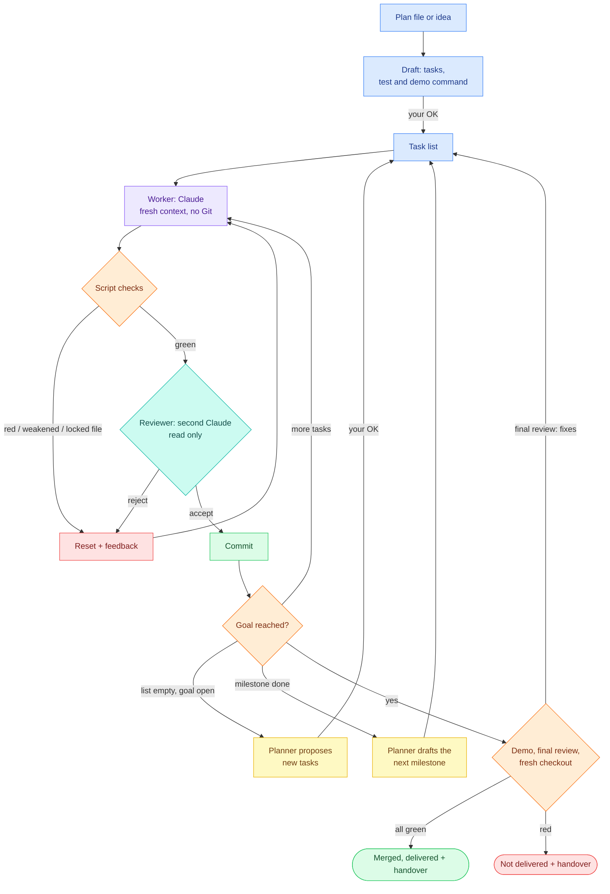

<p align="center">
  <picture>
    <source media="(prefers-color-scheme: dark)" srcset="assets/logo-dark.svg">
    
  </picture>
</p>

<p align="center">
  
  
</p>

**Point it at a plan file (or a few sentences) and [Claude Code](https://claude.com/claude-code) implements it on its own, one task at a time. Script checks, a read-only reviewer and a locked goal guard every task; a demo command at the end decides whether the result is "delivered" – shown to work and handed over with instructions – or not.**

## The idea

Let Claude run all night and in the morning it says "Done!" – and nothing works. Whoever builds also checks their own work, and a list of ticked-off tasks is not a working result. autopilot-loop separates the two and ends with a demo:

- **The worker** (Claude) writes code, one small task per run, with a fresh context and no Git access. It reads the plan and the code itself; only with `MODELS=cheap` a stronger planner model writes a brief for every task first, so the small worker can build it.
- **A shell script** checks the result with hard rules: tests green, test count never drops, only allowed paths touched, the goal untouched.
- **The reviewer** (a second Claude, read-only tools) reads the diff and the test output and rejects weak tests and fakes.
- **Only the script commits.** Anything that fails is reset, and the reason (with the rejected patch) goes into the next attempt.
- **At the end the script runs the demo** (`DEMO_CMD`: use the result the way you would), a final review of the whole change and the tests and demo once more in a fresh checkout, then merges and writes a handover. Without all of that the outcome is "not delivered", however many tasks are ticked off.
- **It learns from its own runs.** Every agent leaves a short note in a journal; the planner condenses it into at most 15 lessons that go into every following prompt.
- **Large plans go milestone by milestone.** The loop drafts the tasks of the next milestone itself when one is done.



Blue is your input (approved by you), purple the worker, orange plain shell checks, teal the reviewer, green what passed, red what was reset or not delivered, yellow the planner.

## Requirements

Linux or WSL (macOS 12.3+ untested), Bash 4.4 or newer, `git`, `tmux`, `jq`, `timeout` (macOS: `gtimeout`), [Claude Code](https://claude.com/claude-code) 2.1 or newer (with `--safe-mode`, `--effort`, `--max-budget-usd`, `--json-schema`) and a login (subscription or API key). Optional: `bwrap` (bubblewrap) for the sandbox. `autopilot doctor` checks all of it.

## Installation

**As a Claude Code plugin** – in a Claude Code session:

```
/plugin marketplace add PlatinBit/autopilot-loop
/plugin install autopilot@autopilot-loop
```

Then `/autopilot-loop` opens a selection menu, `/autopilot-loop <command>` runs any command below, and running projects show up in the status line. Plugin code runs unattended and `trust` only covers `autopilot.conf`, so turn off auto-update for this marketplace and update by hand after reading the changes.

**Optionally in the terminal** (the `autopilot` command without Claude Code, e.g. over SSH):

```bash
git clone https://github.com/PlatinBit/autopilot-loop.git ~/autopilot-loop
~/autopilot-loop/install.sh        # checks the requirements and links `autopilot` into ~/.local/bin
autopilot doctor
```

## Quick start

```bash
autopilot plan ~/my-project/README.md   # or: autopilot plan "A CLI that counts words in Markdown files"
autopilot plan accept                   # after reading the draft: sets up the "autopilot" worktree
cd ~/my-project && autopilot start      # runs in the background until done or a cap is hit
autopilot status                        # while it runs, and afterwards: outcome, tests, cost
autopilot handover                      # what was built, how to try it, the proof
```

- **Plan file inside a Git project:** work happens in a separate worktree `<project>-autopilot` on branch `autopilot`; your working copy stays untouched until the result is delivered, then `main` is fast-forwarded (see [The end](#the-end-final-review-fresh-checkout-merge)).
- **Plan file anywhere else, or an idea:** a project folder `<name>-autopilot/` is created next to it with its own Git repository and a copy of the plan. Nothing else on your system is changed.
- **The better the plan, the further it gets.** Describe what should work in the end, with examples and limits, and add a "Deliverable" section: what you hold in your hands, how you try it, and the one command that proves it (this becomes `DEMO_CMD`).

## Commands

| No. | Command | Effect |
|---|---|---|
| 1 | `autopilot plan <file>` / `plan "<idea>"` | Claude drafts tasks, test and demo command from a plan file (read only). From an idea it first writes `./<slug>-plan.md`, then drafts from it – both are shown; inside a Git project `plan accept` commits that plan file on its own ("Plan: <title>") in your branch, so the work branch has it |
| 1a | `autopilot plan --spec "<idea>"` | writes `./SPEC.md` (requirements, each with 1–2 acceptance examples, non-goals, demo) and stops, so you can correct it; then `autopilot plan SPEC.md` writes the plan from it and drafts, see [Specification first](#specification-first) |
| 2 | `autopilot plan` / `plan accept` / `plan discard` | show / set up or adopt / throw away the draft – or, after a planner round, the planner's suggested tasks (the newer of the two) |
| 3 | `autopilot start` | discards unfinished changes in the work directory, then runs the loop in tmux until delivered, not delivered or a cap (`MAX_RUNS`, `MAX_COST_USD`) |
| 4 | `autopilot status [--short\|--watch]` | running or off, outcome, tasks, tests, acceptance, effort, cost and tokens per kind of Claude call, latest events, next step; `--short`: one line per project for the status line; `--watch`: again every 5 s with the last 5 journal entries, until Ctrl+C |
| 5 | `autopilot stop [--now]` | stop after the current run (a running demo is ended) / now: the unfinished run is discarded |
| 6 | `autopilot handover [--export-lessons]` | `.autopilot/HANDOVER.md`: what was built, where and how to try it, the proof, what is open, cost, next step; `--export-lessons`: writes the lessons (`.autopilot/AGENTS-suggestion.md`) as section "## Lessons from autopilot" into `AGENTS.md` next to `autopilot.conf`, replacing that section if it is there – only on this command, never by itself |
| 7 | `autopilot doctor` | ✔/✘ per tool with version and install command, git identity, sandbox, a probe of the project's test command, a main worktree with uncommitted or untracked files under `MERGE=ff` |
| – | `autopilot trust [file]` / `help` | confirm a hand-written or changed `autopilot.conf` (it is Bash code) / this list |

The project is `./autopilot.conf` (or one in a folder above, up to the Git root), or the file in `$AUTOPILOT_CONF`. `status`, `stop` and `handover` read only `.autopilot/` next to it, so they work even while you edit the configuration.

## Configuration

`autopilot plan accept` writes `autopilot.conf` for you. Only two settings are required:

| No. | Setting | Meaning |
|---|---|---|
| 1 | `TEST_CMD` | builds and runs all tests, exit 0 = green; its output has a count line (`TEST_COUNT_REGEX`, default `^TESTS: ([0-9]+)`) that must never drop and must rise with every task that names no [check command](#check-command-per-task) of its own |
| 2 | `DEMO_CMD` | uses the finished result like you would, exit 0 = it works. Without it the start only warns, and the end is always "not delivered: no demo". One plain command without `&&`, `|`, `;` or redirections, so `plan accept` can let the worker run it; several steps go into a script in the repo, e.g. `bash demo.sh`. The worker prompt offers the demo and a task's check command only when a `WORKER_TOOLS` entry covers exactly that command |

Everything else has a default; [`templates/autopilot.conf`](templates/autopilot.conf) documents each one, [`examples/gradle.conf`](examples/gradle.conf) shows a Gradle project. The start refuses a value of the wrong form (`MAX_RUNS`, `ATTEMPTS`, `MAX_BLOCKED`, `NO_PROGRESS` a whole number, `MAX_COST_USD` a number, `FRESH_CHECK`/`SECRETS_CHECK`/`SIZE_CHECK`/`PR_WAIT` `on` or `off`, `MERGE` `ff`, `off` or `pr`, `SANDBOX` empty, `on` or `off`, `EFFORT_*` `low`, `medium`, `high`, `xhigh` or `max`, `MAX_COST_PER_CALL_USD` a number, `COOLDOWN` a duration like `10m`, `MILESTONE_GATE` `auto` or `ask`, `PARALLEL` 1 to 4). The most useful ones:

| No. | Setting | Default | Meaning |
|---|---|---|---|
| 1 | `MODELS` | `balanced` | `balanced`: worker sonnet, reviewer sonnet, planner opus · `max`: all opus · `cheap`: worker haiku, reviewer sonnet, planner sonnet. Only `cheap` gets a brief per task from the planner; planner, final review and lessons always use the planner model |
| 2 | `MAX_RUNS`, `MAX_COST_USD` | 50, 20 | caps per start (cost of all Claude calls; with a subscription a notional value) |
| 3 | `ATTEMPTS` | 3 | failed attempts per task (script rejection, reviewer no, time limit), then it is blocked |
| 4 | `MAX_BLOCKED` | 3 | blocked tasks, then the loop stops |
| 5 | `NO_PROGRESS` | 10 | accepted runs without a higher acceptance count end the loop; a planner round counts as half of it, so two rounds without progress end it too. Adopting a suggestion resets it |
| 6 | `ALLOWED` | empty | regex of paths the worker may change. Empty: everything except the files that control the test command (`package.json`, `pyproject.toml`, `pytest.ini`, `setup.cfg`, `tox.ini`, `noxfile.py`, `conftest.py`, `jest.config.*`, `vitest.config.*`, `build.gradle*`, `settings.gradle*`, `gradle.properties`, `gradlew`, `gradle/wrapper/*`, `mvnw`, `Cargo.toml`, `go.mod`, `Makefile`, `*.csproj`, `pom.xml`) and the script `TEST_CMD`, `ACCEPT_CMD` or `DEMO_CMD` starts when its first word (or the second after `bash`/`sh`) is a file in the work directory (e.g. `./run-tests.sh`, `bash demo.sh`). The task list, `BLOCKED.md` and the decisions file are always allowed |
| 7 | `LOCKED` | the plan | paths that must never change, e.g. the acceptance test |
| 8 | `ACCEPT_CMD` | empty | optional overall goal printing `ACCEPT: k of n`; may be red, `k` must never drop |
| 9 | `SANDBOX` | on when bwrap works | `off` switches it off |
| 10 | `TRY_IT` | empty | how you try the result by hand, for the handover |
| 11 | `MERGE` | `ff` | delivered: fast-forward `BASE_BRANCH` in the project folder when that is safe; `off` = you merge yourself; `pr` = **push** and open a pull request, see [Pull request mode](#pull-request-mode) |
| 12 | `FRESH_CHECK` | `on` | run the tests once at the start and tests and demo once more before "delivered" in a fresh checkout; `off` for a demo bound to a fixed place or tests that need ignored caches (see [The end](#the-end-final-review-fresh-checkout-merge)) |
| 13 | `FORBIDDEN_CONTENT` | empty | regex of lines that must never be added; a check for secrets (AWS keys, private key blocks, a long literal assigned to a name that is or ends in `password`/`secret`/`token`/`api_key`, e.g. `DB_PASSWORD`, `dbPassword`) runs in addition |
| 14 | `SECRETS_CHECK` | `on` | `off` switches the secrets check off (for false alarms) |
| 15 | `EFFORT_WORKER`, `EFFORT_REVIEWER`, `EFFORT_PLANNER`, `EFFORT_LESSONS` | from `MODELS` | `claude --effort` per role (`EFFORT_PLANNER` also for final review, brief, draft, plan). `balanced`: worker medium, reviewer high, planner high, lessons low · `max`: worker high, the rest xhigh · `cheap`: all medium, lessons low. `CLAUDE_CODE_EFFORT_LEVEL` is removed for every call so the flag holds |
| 16 | `MAX_COST_PER_CALL_USD` | 2 | cap of one Claude call (`--max-budget-usd`); a worker run over it is rejected like a time limit ("hit the per-call budget", the attempt counts), a reviewer over it rejects |
| 17 | `COOLDOWN` | `10m` | an API or network error (overloaded, 5xx, connection reset, API timeout) is no failed attempt: wait this long, 3 times in a row, then it is an error. The usage limit has its own wait |
| 18 | `MILESTONE_GATE` | `auto` | `ask`: after a milestone the next one's tasks wait as a suggestion, the outcome is `waiting`; `autopilot plan accept`, then `autopilot start` goes on |
| 19 | `SIZE_CHECK` | `on` (`off` with `MODELS=cheap`) | before a task's first attempt a short planner call (kind `size`) judges whether it fits one run; if not, the script puts 2–5 parts in its place, see [Size check](#size-check) |
| 20 | `PR_WAIT` | `off` | with `MERGE=pr`: wait up to 30 minutes for the GitHub checks of the pull request; red = not delivered |
| 21 | `PARALLEL` | 1 | up to 4 workers at the same time on independent tasks, each in its own worktree; cost about ×N, see [Parallel workers](#parallel-workers) |

## What you get at the end

Every loop ends with `.autopilot/outcome` (`delivered`, `not-delivered`, `waiting`, `stopped`, `limit` or `error`, tab, reason), `.autopilot/HANDOVER.md`, `.autopilot/demo.txt` and, when there are lessons, `.autopilot/AGENTS-suggestion.md` (see `handover --export-lessons`). **"Delivered" means: all tasks (of all milestones) done, the acceptance test (if any) met, `DEMO_CMD` exited 0, the final review found nothing, and tests and demo passed in a fresh checkout.** Outcome, handover headline, `status --short` and the toast read "delivered, merged into main", "delivered (not merged: reason)" or, with `MERGE=off`, just "delivered". The handover says "Merged into main" or "Not merged: reason" with the command to do it, names the fresh checkout ("tests and demo green" or "off") in the proof, names the folder to try it in, shows command, exit code and last lines of the demo and the tests, the blocked tasks, new dependencies (lines added to `package.json`, `requirements*.txt`, `pyproject.toml`, `build.gradle*`, `Cargo.toml`, `go.mod`, `pom.xml`, `Gemfile`, `composer.json`), the cost and tokens per kind of Claude call (plan, spec, draft, size, brief, worker, reviewer, planner, lessons, final – all in `.autopilot/costs.csv`), the lessons, the last 10 journal entries and the next step.

## The end: final review, fresh checkout, merge

When the task list (of the last milestone) is done and the demo is green:

1. **Final review.** A planner-model Claude reads the plan, the whole `git diff <BASE_BRANCH>...HEAD` (at the end of an earlier milestone only the change since that milestone began) and the journal entries of reviewers, final review and script – no lessons and no worker notes ([`templates/FINAL.md`](templates/FINAL.md)): goals missing, leftovers, unhandled failures, security, a README with the start command. A diff over 1500 lines is cut to `--stat` plus its first 1500 lines. Its answer is JSON (`--json-schema`): `ok` goes on; otherwise its (at most 5) fix tasks are appended and the loop works them off; an answer with neither is asked for once more. If the second round still finds issues, the end is "not delivered: final review still finds issues" with the points in the handover. Two rounds per milestone (`.autopilot/final-rounds`, reset at every start).
2. **Fresh checkout.** `git worktree add --detach` of HEAD in a temporary folder, `TEST_CMD` and `DEMO_CMD` there, then the folder is removed. Red means "not delivered: works only in the work directory" (e.g. it needs an ignored file); a checkout that cannot be made is reported as such. The start already runs `TEST_CMD` there once and refuses to start when it is red, so this does not show up only after all the runs. Trade-off: a fresh checkout has no ignored files (`node_modules/`, `.venv/`, build caches), and with the sandbox there is no network to fetch them – a `TEST_CMD` that needs them is red there. Then, or for a demo bound to a fixed place: `FRESH_CHECK=off`.
3. **Merge.** With `MERGE=ff` (default) `BASE_BRANCH` is fast-forwarded in the project's main worktree – only if that worktree is on `BASE_BRANCH`, has no uncommitted or untracked changes, no file the branch changed lies there as an ignored file (the fast-forward would overwrite it) and a pure fast-forward is possible. Otherwise nothing changes and the handover gives the reason and the command. `MERGE=off` never merges.

## Large projects: milestones

A plan with sections `## Milestone 1: …`, `## Milestone 2: …` (what `autopilot plan "<idea>"` writes) is worked through one milestone at a time: `plan` drafts only the tasks of the first one. When a milestone is done (all tasks `[x]`, final review OK), the planner drafts the tasks of the next one from the locked plan and the loop appends them and goes on without asking; the journal notes it. With `MILESTONE_GATE=ask` they wait as a suggestion instead (outcome `waiting`, "milestone N done, approve with autopilot plan accept"); a start refuses until you adopt (`plan accept`) or throw them away (`plan discard`). The current milestone and the commit it started at are in `.autopilot/milestone`. The demo, the acceptance goal (`ACCEPT_CMD` at `n of n`), the fresh checkout and "delivered" come only after the last milestone. Headings inside code blocks do not count. A plan without such headings works as one list.

## Task dependencies

A task names the tasks it needs right after its number: `- [ ] 5. (after 2, 4) Export. Done when …`. The next task is the first open one whose dependencies are all ticked off (`[x]`); `after 3` also covers the parts `3.1`, `3.2` … of a split task, and a number no task has counts as done. Without `(after …)` the list is worked from top to bottom as before. A task that depends on a blocked one (`[~]`), directly or through another, is skipped; when only such tasks are left the loop ends ("N open tasks wait on blocked tasks") and the handover lists each as "waiting on blocked task N". The worker gets the picked task named in its prompt, and the script accepts only that line ticked off or blocked – any other change to the task list is rejected. `plan`, the planner and the final review may set dependencies.

## Size check

With `SIZE_CHECK=on` (default, except `MODELS=cheap`) a short planner call ([`templates/SIZE.md`](templates/SIZE.md), answer `{fits, split}` via `--json-schema`, effort and model of the planner, kind `size` in `costs.csv`) judges each task once before its first attempt. If it does not fit one run, the script – not the worker – replaces the line by 2 to 5 parts `N.1`, `N.2` …, each with the task's `(after …)`, commits that as "Autopilot: split task N" and notes it in the journal; no attempt and no run is used. The last part must keep the task's check command (otherwise the task stays as it is), and a task without a number is never split. `.autopilot/sized` remembers what was checked, so neither a task nor its parts are checked twice, also after a restart.

## Specification first

`autopilot plan --spec "<idea>"` writes `./SPEC.md` ([`templates/SPEC.md`](templates/SPEC.md)): the requirements as a numbered list, each with one or two acceptance examples ("Given … when … then …" or `` `command` → output``), the non-goals and the demo command. It shows the file and stops. Correct it, then `autopilot plan SPEC.md` writes `<title>-plan.md` next to it from the spec and drafts as usual. `plan accept` commits both files, locks both (`LOCKED`) and sets `SPEC_FILE`, so planner, worker, size check and final review get the spec like the plan, and the final review checks every acceptance example against the result. Without `--spec` nothing changes.

## Pull request mode

**`MERGE=pr` pushes your code to a remote: an action outside this machine.** When the result is delivered, the script pushes the work branch to `origin` (`git push origin HEAD:refs/heads/<branch>`, no force) and opens a pull request against `BASE_BRANCH` with `gh pr create` (title: the plan's first heading, body: the first 80 lines of the handover), or reuses the one already open for the branch. The outcome reads "delivered, PR opened: <url>", the handover names `gh pr merge <url>`. With `PR_WAIT=on` it then waits up to 30 minutes for the checks (`gh pr checks --watch`): red (or not done in time) is "not delivered: CI red: <url>" with the output in the handover (`.autopilot/ci.txt`), and with `PLANNER=on` the planner gets that output like a red demo. The start refuses `MERGE=pr` unless `gh` is installed and logged in (`gh auth status`) and the work directory has a remote `origin`; `doctor` shows the same. Default stays `MERGE=ff`, which never leaves the machine.

## Parallel workers

**`PARALLEL=N` (2 to 4) runs up to N workers at the same time: the cost per wave is about N times a run, and tasks that touch the same lines conflict.** Use it only for tasks that are really independent, with their dependencies written in the plan (`(after …)`); the default `PARALLEL=1` is the serial loop, unchanged.

A wave takes up to N tasks that can start now (open, dependencies done; so none of them waits on another) and that were not rejected before. Size check and brief run first, one task after the other. Each worker then works in its own temporary worktree of HEAD (`git worktree add --detach`, its working directory: relative `WORKER_TOOLS` entries like `Bash(./gradlew:*)` and `sandbox-run` act there, `.git` stays read-only in the sandbox) with its own prompt and its own entry in the journal. When all are done, the script merges them strictly one by one in task order: the worker's diff against the wave's start is applied to the current HEAD (`git apply --3way`), then the whole check chain runs on the merged state – allowed paths, locked files, task list, tests and the task's check command, acceptance test, secrets, reviewer (with this task's diff and the test output after the merge) – and only then the commit. A rejection resets only that change; the others stay.

- The task list never comes from a worker: its own line ticked off (`[x]`) or blocked (`[~]`) in its copy is required as before, any other change to the list is rejected; the script then sets that mark itself. Lines a worker only appends to the decisions file or `BLOCKED.md` are appended to the current file, so workers that each note a decision do not conflict.
- A conflict is no failed attempt: the task gets "conflict with parallel task N, retry on the new base" with its diff as feedback, and is tried again in a later wave or alone; after 2 conflicts only alone. A task rejected in a wave goes on alone with its attempt counted and its feedback (`.autopilot/pending/`, survives a restart).
- `MAX_RUNS` counts every worker; before a wave the script checks that N more workers at the mean worker cost so far fit into what is left of `MAX_COST_USD`, otherwise the wave is smaller ("Cost cap: … wave of k"); a wave of 1 is the serial run. A usage limit or API error of a worker counts no attempt; the wave is merged, then the loop waits.
- `status` (and `--watch`) shows the running wave, `status --short` "wave of N"; `stop --now` ends all workers and removes all temporary worktrees, the handover names the discarded wave. Lessons are condensed once after the wave.
- Workers start from a fresh checkout without ignored files (`node_modules/`, build caches), like the fresh check; their test calls are slower or need those tools elsewhere.

## Check command per task

A task line ``- [ ] 4. Export. Done when `./bin/tool export x.md` exits 0 …`` names its own check: after the run the script runs the command in backticks in the work directory (sandbox and time limit like `TEST_CMD`); a non-zero exit rejects the run with its output. Such a task does not need to raise the test count. Without a command in backticks the old rule holds: every ticked-off task adds tests.

## Journal and lessons

Every agent leaves a short note (`did`, `problem`, `hint`): worker and brief as a block at the end of their answer, reviewer, planner and final review in the `note` field of their JSON answer (`--json-schema`). The script takes it and appends it, with time, role, task and result, as entry `J<n>` to `.autopilot/JOURNAL.md`. Only the script writes this file, it is never shortened and the numbers run on over restarts; read it any time to see what happened and why a run failed. Only `did:`/`problem:`/`hint:` lines of the last block (or those three fields, each made one line) pass (at most 3 lines, 600 bytes), so no agent can plant headers or long text into later prompts. Those lines are still an agent's own words: the gatekeepers (reviewer and final review) therefore see only entries of reviewers, the final review and the script, and no lessons. The rejection reason itself still goes to the next attempt as feedback, with the rejected patch.

From the journal a planner run condenses `.autopilot/LESSONS.md`: at most 15 one-line rules, each pointing to the journal entries it is based on, for example `- Run the build twice after a dependency change. (J12, J17)`. The lessons are condensed again after every timeout, every blocked task and every 5 accepted tasks (not after every rejection, to save cost); outdated lessons are dropped, and an invalid answer keeps the old file.

Lessons are hints, never rules: every prompt marks journal and lessons as notes that cannot override the plan, CLAUDE.md, locked files, the acceptance test or the prompt rules, and they never cover decisions that belong to you.

To remove a lesson, edit its line in `LESSONS.md` so it starts with `- [removed by owner]`, e.g.
`- [removed by owner] Skip the slow integration test. (J8)`
It stays removed and is not brought back, not even reworded; a lesson that comes back with the same words is dropped by the script. Delete the whole file to start over.

Token cost: every prompt gets the last 25 journal entries (about 25 x 150 tokens, roughly 4k), worker, brief and planner also all lessons (under 1k). Condensing the lessons costs one extra planner run each time (kind `lessons` in `costs.csv`).

In Claude Code the status line shows each running project; when one ends, a toast leads with the outcome: "Autopilot shop: Delivered, merged into main - 5 done, 1 blocked, tests 114 -> 131, 4.20 USD - /autopilot-loop handover". Desktop notifications use `notify-send` where it exists; a `notify()` in `autopilot.conf` replaces it.

## Safeguards

| No. | Building block | What it prevents |
|---|---|---|
| 1 | **Plan as the goal**: given to planner and brief, locked | the loop rewriting its own goal |
| 2 | **One task per run, fresh context** | getting lost in old failed attempts, a full context |
| 3 | **Script checks** (no AI judgement): tests green, count never drops, every ticked-off task adds tests or passes its own check command, only allowed paths, locked files untouched, no forbidden content, no new code printing the count line, nothing written by the test command slips into the commit | "done" without proof, deleted tests, tampering with the checks or the plan |
| 4 | **Reviewer**: second Claude, read only | weak tests, fakes with fixed numbers |
| 5 | **Feedback**: reason and rejected patch go into the next attempt | blindly repeating the same mistake |
| 6 | **Brakes**: `ATTEMPTS` per task (counted in `.autopilot/attempts`, survives a restart), `MAX_BLOCKED`, `NO_PROGRESS`, `MAX_RUNS`, `MAX_COST_USD`, `MAX_COST_PER_CALL_USD`, waiting at the usage limit and (`COOLDOWN`) after API errors | endless loops that only burn quota |
| 7 | **Planner** proposes tasks only with your OK, says "not reachable" instead of inventing work; a blocked task may not come with code | standstill, invented tasks, half-built work slipping in as "blocked" |
| 8 | **Demo and handover** | "done" that nobody can start |
| 9 | **Final review and fresh checkout** before "delivered" | leftovers no single task review sees, a result that works only in the work directory |
| 10 | **Journal and lessons**, only did/problem/hint lines, marked as hints; reviewer and final review get no worker notes and no lessons | the same mistake in run after run; notes smuggling in instructions |
| 11 | **Secrets check** on every added line, besides `FORBIDDEN_CONTENT` | keys and passwords in the commit |

## Limits

| No. | Limit | How to deal with it |
|---|---|---|
| 1 | Only what can be checked automatically is checked | look, feel and UX stay with you; the demo proves the result starts and answers |
| 2 | The reviewer can be wrong (both ways) | at most `ATTEMPTS` tries per task, then it lands with you in `BLOCKED.md` |
| 3 | Cost | caps per start; with a subscription the loop pauses at the usage limit; `status` shows cost and tokens per kind |
| 4 | Claude Code refuses every write below `~/.claude/` | keep projects elsewhere; `plan accept` refuses such a work directory, `doctor` warns |
| 5 | Tasks of the next milestone, of the final review and the parts of a split task are added without your OK, and their check commands run like `TEST_CMD` | milestone tasks are drafted from the locked plan, final-review tasks from the final reviewer's reading of the change (at most 5, two rounds), parts must keep the split task's check command; read the journal and `git log`; the run caps still apply; `SIZE_CHECK=off` turns splitting off |
| 6 | `PARALLEL` > 1: workers in a wave do not see each other's changes | only independent tasks with dependencies in the plan; conflicts are retried on the new base, at most twice, then alone |

## Upgrading from 0.9

| No. | 0.9 | 0.10 | What to do |
|---|---|---|---|
| 1 | any Claude Code 2.1 | needs `--effort`, `--max-budget-usd`, `--json-schema` (the start refuses otherwise) | update Claude Code; `autopilot doctor` names a missing flag |
| 2 | reviewer, planner and final review answered with `VERDICT:`/`FINAL:`/`NOT REACHABLE` lines and a `<<<NOTE` block | a JSON answer (`--json-schema`) | a custom `REVIEWER_FILE`/`PLANNER_FILE` should ask for the JSON fields instead of those lines (the schema is enforced anyway) |
| 3 | no cap per call | `MAX_COST_PER_CALL_USD=2` | raise it for big plans or diffs (`plan` names it when a draft stops there) |
| 4 | `costs.csv` with 7 columns | 8th column `effort` | nothing: the header is updated, old rows stay |
| 5 | the worker took the first open task | the script picks the task (dependencies) and names it in the prompt | a custom `PROMPT_FILE` should say "take the task named under This run" |
| 6 | no size check | `SIZE_CHECK=on` with `balanced`/`max`: one short planner call per task | `SIZE_CHECK=off` to save it |

## Upgrading from 0.8

Existing configurations may break; this table says what to change. After editing `autopilot.conf`: `autopilot trust`.

| No. | 0.8 | 0.9 | What to do |
|---|---|---|---|
| 1 | `autopilot` without arguments opened a whiptail menu | prints the help | use the commands, or `/autopilot-loop` in Claude Code |
| 2 | `~/.config/autopilot-loop/standard.conf` pointed at the last project | gone: `$AUTOPILOT_CONF`, then `./autopilot.conf` or one above up to the Git root | run commands in the project folder, or set `AUTOPILOT_CONF` |
| 3 | `autopilot start 10 opus 3 sonnet opus` | `autopilot start` | runs and cost: `MAX_RUNS` (50), `MAX_COST_USD` (20); models: `MODELS` |
| 4 | `PLANNER_MODEL`, `WORKER_MODEL`, `REVIEWER_MODEL` (environment, default opus/opus/sonnet); a brief per task whenever worker and planner differed | `MODELS=balanced\|max\|cheap`; a brief only with `cheap` | pick the preset that fits; `max` is opus everywhere |
| 5 | `MAX` (environment) | `MAX_RUNS` | rename |
| 6 | `MAX_REJECTIONS`, "two reviewer rejections", "two time limits" | `ATTEMPTS` (3) per task, over all failures | delete the old names |
| 7 | `STALL_WARN_AFTER`, `.autopilot/planner-rounds` | `NO_PROGRESS` (10; a planner round counts half) | rename `STALL_WARN_AFTER` (a conf that still has it gets a warning at the start); the old file is ignored |
| 8 | `ALLOWED` required, had to include the task list | optional; task list, `BLOCKED.md`, decisions always allowed | keep yours or delete it for the new default |
| 9 | `ACCEPT_FILES`, `autopilot approve`, `APPROVAL`, `ACCEPT_LIST_CMD`, `conditions` | gone: lock the acceptance test with `LOCKED` | move the paths of `ACCEPT_FILES` into `LOCKED=(…)` – a conf that still has `ACCEPT_FILES` is refused at the start, `ACCEPT_LIST_CMD` only warned about |
| 10 | `SANDBOX=on` / `off` | on whenever bwrap works; `SANDBOX=off` switches it off | `SANDBOX=on` may stay; without bwrap the start now warns instead of refusing |
| 11 | `SUPERVISED`, `LICENCE_*`, `continue`, `grades`, `[tag]` kinds | gone | delete (a conf with `SUPERVISED` or `LICENCE_*` is refused at the start); `[tag]` in task lines is plain text now |
| 12 | `SMOKE_TEST_CMD`, `SMOKE_TEST_EVERY`, `IMAGE_REVIEW_*` | gone | put the real run into `DEMO_CMD` (a conf that still has them is refused at the start) |
| 13 | `REPORT_MODEL`, `report`, `chart`, `costs`, `result`, `notes`, `summary`, `setup` | gone | `status` shows outcome, cost and tokens; `handover` the result; write a conf by hand from [`templates/autopilot.conf`](templates/autopilot.conf); a conf with `REPORT_MODEL` is refused at the start |
| 14 | `abort` | `stop --now` | |
| 15 | `propose`, `suggestion [accept\|discard]` | the planner runs inside the loop; `plan` / `plan accept` / `plan discard` | |
| 16 | `plan idea "<idea>"`, then `plan <file>` | `plan "<idea>"` does both | |
| 17 | `plan accept --no-demo` / `--with-accept` | gone | without a demo only a warning; an acceptance test of the draft is adopted when its files exist |
| 18 | `NAME`, `BASE_BRANCH` | `NAME` = folder name, `BASE_BRANCH` read from the worktree when empty | may stay |
| 19 | `.autopilot/log/progress.csv`, `costs-extra.csv`, `grades.csv` | `.autopilot/costs.csv` (every Claude call with tokens) | old files are ignored; delete them when you like |
| 20 | `.autopilot/feedback.txt` only | plus `.autopilot/JOURNAL.md` and `LESSONS.md` in every prompt | nothing; a custom `PROMPT_FILE`/`REVIEWER_FILE` gets journal, lessons and the note instruction appended by the script |
| 21 | "delivered" = tasks done + demo green | + final review OK + tests and demo green in a fresh checkout; the start refuses when `TEST_CMD` is red there | a demo bound to a fixed place (a test server, absolute paths) or tests that need ignored caches: `FRESH_CHECK=off` |
| 22 | "delivered" left the merge to you | `MERGE=ff`: `BASE_BRANCH` is fast-forwarded when safe | to keep merging yourself: `MERGE=off` |
| 23 | `FORBIDDEN_CONTENT` was the only content check | a secrets check runs in addition | a test that needs a long fake token: build it at runtime instead of writing it as a literal; false alarms: `SECRETS_CHECK=off` |
| 24 | "Done when …" was text only | a command in backticks after "Done when" is run and must exit 0 | check your task lines: a backtick command that is meant to fail needs `!` in front |
| 25 | the whole plan as one task list | `## Milestone N` sections are worked off one by one | a plan without such headings behaves as before |

## Security

The checks protect the **quality** of the work. They are **not a security boundary**: the test command runs code Claude wrote, with your user rights. Best run the autopilot on a separate machine, VM or container. On Linux with bubblewrap, test, acceptance and demo command run without network and devices, read-only outside the work directory and with a read-only `.git` and `.autopilot/`. **The worker's own Bash calls are not covered by it** unless they go through the bundled `sandbox-run` wrapper – `autopilot plan accept` sets that up when bubblewrap works.

| No. | Protection | Against |
|---|---|---|
| 1 | An `autopilot.conf` is only loaded once you confirmed it (`autopilot trust`, automatic after `plan accept`); every change needs a new confirmation | foreign repos with a prepared `autopilot.conf`, changes by the worker |
| 2 | Only a few settings from Claude's draft are adopted, in a strictly checked form; tools only `Read`, `Edit`, `Write`, `Glob`, `Grep` and `Bash` for a single command (`plan accept` adds the test, demo and check commands of the draft as whole commands, metacharacter-free ones only) | prompt injection through the plan or the project |
| 3 | All Claude runs with `--safe-mode` (no foreign hooks, plugins, MCP servers; the project's `CLAUDE.md` goes into the prompt as text) and without write access to `.git`, `.claude`, `.autopilot`, `autopilot.conf` | hooks and permissions from a foreign `.claude/settings.json` |
| 4 | Git without hooks, fsmonitor and external diff programs; if a run changes `.git` (config, info, hooks), the autopilot stops immediately | code execution through Git management files |
| 5 | `.git*`, `.github/`, `.claude/`, `.autopilot/`, `autopilot.conf`, `CLAUDE.md` are always locked; renames are checked with old and new path; symlinks out of the work directory are rejected | bypassing the path check |

For plans or repos from others, run it in a container or VM without access to keys and private data. Never use `--dangerously-skip-permissions` on your own system. Read drafts before accepting them: `TEST_CMD`, `TEST_COUNT_CMD`, `DEMO_CMD` and `ACCEPT_CMD` are shell commands.

## Self-test

```bash
test/test_autopilot.sh                              # fake `claude`: loop, plan, security, brakes, demo, handover, costs, journal, lessons, milestones, final review, merge → "ok"
claude plugin validate . && claude plugin test .    # the Claude Code plugin: menu, status line, finish toast
```

License: MIT.
